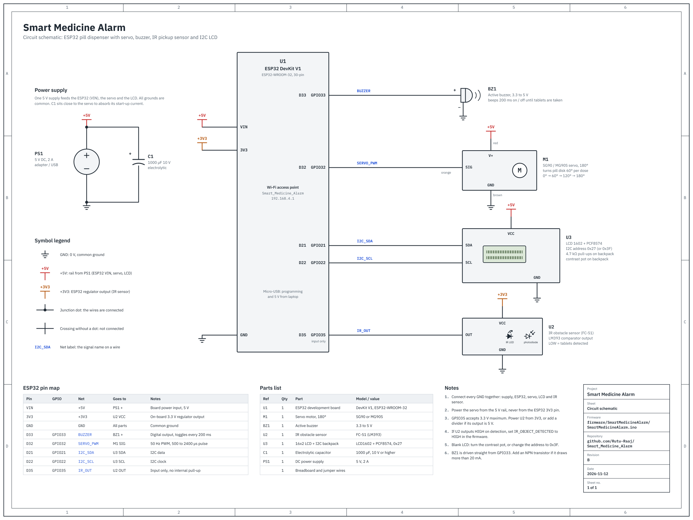

# Smart Medicine Alarm

An ESP32-based pill dispenser that reminds a patient to take their medicine three times a day. At each dose time it rotates a pill disk to the next compartment, sounds a buzzer, and shows a prompt on an LCD. The alarm keeps sounding until an IR sensor confirms the tablets were taken from the tray.

The ESP32 creates its own Wi-Fi network, so the system works without internet. You can monitor and configure it from a phone browser or from a desktop app on a laptop.

## Features

- Three daily dose times, saved in the ESP32's flash memory, so they survive a power cut
- Servo-driven pill disk that moves slowly and smoothly (ease-in, ease-out) to avoid spilling tablets
- Buzzer alarm that stops only after the IR sensor sees the tablets and then sees them removed
- 16x2 I2C LCD showing the current time, slots left, and the next dose
- Built-in web dashboard at `http://192.168.4.1`, works on any phone or laptop browser
- Desktop dashboard (`dashboard/dashboard.py`) with a pill-tray view showing each dose as Dispensed, Next, Take now, Missed, or Upcoming
- The device clock is set automatically from the connected phone or laptop, so no RTC module or internet is needed
- JSON HTTP API for status, time sync, schedule changes, and reset

## Repository layout

```
Smart_Medicine_Alarm/
├── firmware/
│   └── SmartMedicineAlarm/
│       └── SmartMedicineAlarm.ino   ESP32 firmware, including the built-in web dashboard
├── dashboard/
│   ├── dashboard.py                 Desktop dashboard (Python, CustomTkinter)
│   └── requirements.txt             Python dependency for the desktop dashboard
├── docs/
│   └── circuit-schematic.png        Full circuit schematic
├── .gitignore
└── README.md
```

The Arduino IDE requires a sketch to sit in a folder with the same name, which is why the firmware is in `firmware/SmartMedicineAlarm/`.

## Circuit diagram



The schematic shows every connection, with a pin map, parts list, and wiring notes. Open [`docs/circuit-schematic.png`](docs/circuit-schematic.png) for the full-size image.

## Hardware

| Part | Notes |
|---|---|
| ESP32 DevKit V1 (30-pin) | Any ESP32 dev board with the pins below |
| SG90 or MG90S servo (180°) | Must be a 180° positional servo, not a 360° continuous one |
| Active buzzer | 3.3 V or 5 V |
| IR obstacle sensor module | Placed so it sees the tablets in the tray |
| 16x2 LCD with I2C backpack | Address `0x27` (some modules use `0x3F`) |
| 5 V supply, 2 A recommended | Powers the servo separately from the ESP32 |
| 470 to 1000 µF capacitor | Across the servo power pins |

### Pin map

| ESP32 GPIO | Connected to |
|---|---|
| GPIO 21 | LCD SDA |
| GPIO 22 | LCD SCL |
| GPIO 32 | Servo signal (orange or yellow wire) |
| GPIO 33 | Buzzer (+) |
| GPIO 35 | IR sensor OUT |

### Wiring notes

- **Servo power:** connect the servo's red wire to 5 V, never to the ESP32's 3V3 pin. A servo can draw 650 to 700 mA when it starts moving. A weak supply makes it jitter or resets the ESP32.
- **Common ground:** the ESP32, servo, LCD, IR sensor, and external supply must all share GND.
- **IR sensor output:** GPIO 35 accepts 3.3 V maximum. If your IR module outputs 5 V, use a voltage divider.
- **IR polarity:** the firmware expects the sensor output to be `LOW` when it detects tablets. If your module works the other way, change `IR_OBJECT_DETECTED` to `HIGH`.

## Flashing the firmware

1. Install the [Arduino IDE](https://www.arduino.cc/en/software).
2. Add the ESP32 board package:
   - Open **File > Preferences**.
   - Add this URL to **Additional boards manager URLs**:
     `https://espressif.github.io/arduino-esp32/package_esp32_index.json`
   - Open **Tools > Board > Boards Manager**, search for `esp32`, and install **esp32 by Espressif Systems**.
3. Install the libraries from **Sketch > Include Library > Manage Libraries**:
   - **ESP32Servo** by Kevin Harrington (version 3.x)
   - **LiquidCrystal I2C** by Frank de Brabander
4. Open `firmware/SmartMedicineAlarm/SmartMedicineAlarm.ino`.
5. Select **Tools > Board > esp32 > ESP32 Dev Module** and the correct **Tools > Port**.
6. Click **Upload**. If the upload stops at `Connecting....`, hold the board's **BOOT** button until the upload starts.

After the upload, the LCD shows `WiFi: Medicine` and `192.168.4.1`.

## Using the system

### Phone or laptop browser

1. Connect to the Wi-Fi network **Smart_Medicine_Alarm** (password `12345678`). If the phone warns that the network has no internet, choose to stay connected.
2. Open `http://192.168.4.1`. Type `http://` in full, because some browsers try `https` and fail.
3. The page sends your device's time to the ESP32 automatically. Check that **Device time** matches your phone.
4. Set the three dose times and select **Save schedule**.

### Desktop dashboard

Tested with Python 3.11 and CustomTkinter 6.0.

```
cd dashboard
pip install -r requirements.txt
python dashboard.py
```

The laptop must be connected to the **Smart_Medicine_Alarm** Wi-Fi network. The dashboard refreshes every 5 seconds and follows the Windows light or dark theme.

### What happens at a dose time

1. The servo turns the pill disk 60° to the next compartment (0° → 60° → 120° → 180°).
2. The buzzer starts beeping and the LCD shows `Take Medicine`.
3. The dashboards show a red **Time to take medicine** alert.
4. After the disk stops, when the IR sensor sees the tablets and then sees them removed (each for at least 0.5 s), the alarm stops and the dose is marked as dispensed.

If the LCD shows `Power dip reset` at start-up, the ESP32 was reset by a voltage drop, usually when the servo started. Power the servo from a 5 V, 2 A supply instead of the laptop's USB port.

At midnight the dose list resets for the new day. **Reset doses** clears today's doses and returns the servo to 0°.

## Device API

All endpoints use HTTP GET and return JSON. The device is at `http://192.168.4.1`.

| Endpoint | Parameters | Purpose |
|---|---|---|
| `/api/status` | none | Current time, next dose, slots left, alarm and sensor state, servo angle, and the three doses |
| `/api/settime` | `epoch` (Unix time, UTC) | Sets the device clock |
| `/api/schedule` | `h1, m1, h2, m2, h3, m3` | Saves three dose times (24-hour). Doses already given today stay given. |
| `/api/reset` | none | Marks all doses pending, stops the alarm, returns the servo to 0° |

Example:

```
http://192.168.4.1/api/schedule?h1=8&m1=0&h2=14&m2=0&h3=20&m3=0
```

## Configuration

These constants are at the top of `firmware/SmartMedicineAlarm/SmartMedicineAlarm.ino`:

| Constant | Default | Meaning |
|---|---|---|
| `AP_SSID`, `AP_PASSWORD` | `Smart_Medicine_Alarm`, `12345678` | Wi-Fi network created by the ESP32. Change the password before real use. |
| `IR_OBJECT_DETECTED` | `LOW` | Sensor output level when tablets are present |
| `IR_STABLE_MS` | `500` | How long a sensor reading must hold before the alarm trusts it. Raise it if the alarm stops by itself. |
| `SERVO_MS_PER_DEGREE` | `35` | Servo speed. A 60° step takes about 2.1 s. Larger is slower. |
| `SERVO_MIN_US`, `SERVO_MAX_US` | `500`, `2400` | Servo pulse width at 0° and 180°. Calibrate for your servo. |
| `SERVO_STEP_DEGREES` | `60` | Rotation per dose |
| Timezone | `IST-5:30` | Set in `setDeviceEpoch()`. Change for other regions. |

In `dashboard/dashboard.py`, `REFRESH_MS` sets how often the desktop dashboard checks the device (default 5000 ms).

## Known limitations

- **No real-time clock module.** After a power cut, the ESP32 does not know the time until a phone or laptop opens a dashboard. Doses do not fire while the clock is not set.
- **Doses fire only during their exact minute.** If the device is off or its clock is not set at that minute, the dose is skipped. The desktop dashboard shows it as **Missed**.
- **The servo is not returned to 0° at midnight.** Select **Reset doses** after refilling the pill disk each day.
- **The alarm has no timeout.** If the IR sensor never detects tablets (for example, an empty compartment), the buzzer keeps sounding until **Reset doses** is selected.
- **No authentication.** Anyone who joins the Wi-Fi network can change the schedule. Change the default Wi-Fi password.
